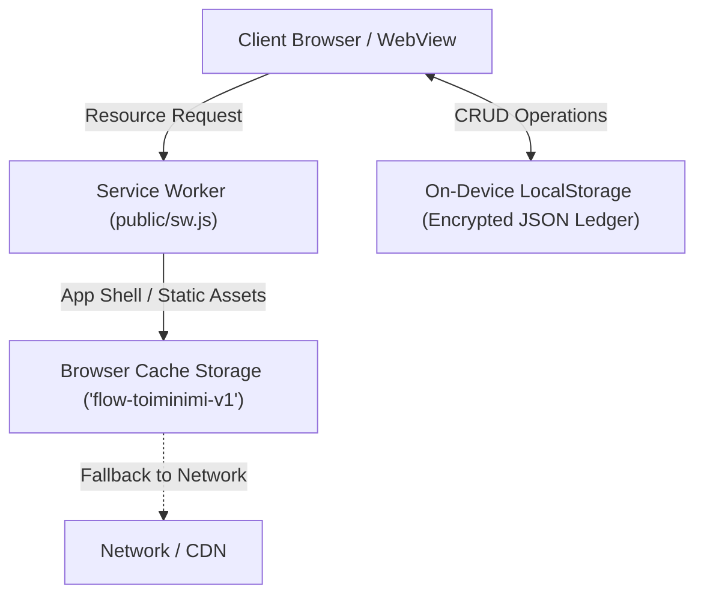

# System Architecture & Technical Specifications
## Project: Toiminimi Flow

---

## 1. Architectural Philosophy: The Two-Tier Privacy Model

Toiminimi Flow is designed for Finnish sole traders (*toiminimiyrittäjät / yksityiset elinkeinonharjoittajat*). Accounting data contains sensitive personal income, billing rates, client identities, and profit margins.

To balance zero-friction onboarding with modern multi-device convenience, the system is architected in **Two Distinct Tiers**:

```
┌────────────────────────────────────────────────────────────────────────────────────────┐
│                                 TOIMINIMI FLOW SUITE                                   │
└───────────────────────────────────────────┬────────────────────────────────────────────┘
                                            │
               ┌────────────────────────────┴────────────────────────────┐
               ▼                                                         ▼
┌──────────────────────────────────────────────┐ ┌──────────────────────────────────────────────┐
│  Tier 1: Instant Local Mode (Unregistered)   │ │  Tier 2: Registered Cloud Sync (Firebase)    │
├──────────────────────────────────────────────┤ ├──────────────────────────────────────────────┤
│ • Zero signup or login required              │ │ • Google & Apple Sign-In ONLY                │
│ • Runs 100% on-device in browser storage     │ │ • Firebase Authentication backend            │
│ • No backend servers or user tracking        │ │ • Cloud receipt archival (Drive/iCloud/GCS)  │
│ • Receipts stored via Link / File Path       │ │ • Seamless cross-device encrypted sync       │
│ • Complete single-entry bookkeeping & PDF    │ │ • Multimodal Gemini AI Receipt Scanner       │
│ • Form 5 & VAT OmaVero 1-click helpers       │ │ • Total privacy: only Auth ID is preserved   │
└──────────────────────────────────────────────┘ └──────────────────────────────────────────────┘
```

### Tier 1: Instant Guest Mode (Current Baseline)
- **Zero Signup Friction**: Sole traders can start using the application immediately without creating an account or providing email/passwords.
- **Client-Side Zero Knowledge**: Ledger data is stored strictly in browser storage (`localStorage` / Cache). No telemetry, no third-party ad tracking, no corporate database.
- **External Receipt Links & Local Paths**: Because browser `localStorage` is capped at ~5MB, receipts are referenced as URLs (Google Drive, iCloud, Dropbox, OneDrive) or local paths (`/receipts/2026/01.pdf`). This ensures storage remains practically unlimited and lightning-fast.
- **Complete Feature Parity**: Full invoicing, PDF generation, tax calculations, Form 5 mapping, and JSON backup/restore work 100% offline.

### Tier 2: Registered Cloud Sync (Firebase Backend Roadmap)
- **Authentication**: Strict **Google OAuth** and **Apple Sign-In** only. No custom password databases, no unvetted credential storage.
- **Personal Cloud Storage**: Receipts upload directly to personal cloud storage (Google Drive, iCloud, or Firebase Cloud Storage).
- **Encrypted Sync**: Firebase Firestore / Storage manages cross-device synchronization between mobile and desktop while maintaining end-to-end data ownership.
- **Multimodal AI Receipt Scanner**: Automated receipt processing using Google Gemini 2.5 Flash, extracting dates, amounts, and VAT categories.

---

## 2. Component Hierarchy & Module Map

```mermaid
graph TD
    Root["index.tsx (Entry Point)"]
    App["App.tsx (Navigation Shell & Responsive Layout)"]
    
    subgraph Views ["Core Application Views"]
        Dash["Dashboard.tsx (Cashflow, Tax Safe, Recharts)"]
        TaxC["TaxCenter.tsx (VAT & Tax Deadlines)"]
        Deduct["DeductionsView.tsx (Mileage 378 & Home Office)"]
        InvForm["InvoiceForm.tsx (Invoicing & Itemization)"]
        ExpForm["ExpenseForm.tsx (Expense Vouchers & Links)"]
        CustMgr["CustomerManager.tsx (Client Directory)"]
        BizForm["BusinessInfoForm.tsx (Business Profile & IBANs)"]
        DataBak["DataBackup.tsx (JSON Export & Restore)"]
    end

    subgraph Modals ["Specialized Assisted Modals"]
        F5Modal["Form5AssistantModal.tsx (OmaVero Line 300-380 Helper)"]
        PrepModal["PrepaymentGuideModal.tsx (Ennakkovero Guide)"]
        SettModal["SalesSettlementModal.tsx (Card/POS Payouts)"]
    end

    subgraph Primitives ["Apple HIG UI Primitives"]
        BSheet["components/ui/BottomSheet.tsx (Gesture Modal)"]
        PullRef["components/ui/PullToRefresh.tsx (iOS Haptic Pull)"]
        TextRev["components/ui/TextReveal.tsx (Inspection Popover)"]
    end

    subgraph Services ["Domain Engines"]
        Vero["services/veroTaxEngine.ts (Finnish Tax Rules)"]
        Format["services/formatUtils.ts (SFS 4175 Formatting)"]
        Store["services/storageService.ts (CRUD & Reference Gen)"]
        PDF["services/pdfService.ts (jsPDF Finnish Payment Slip)"]
        Cal["services/calendarService.ts (RFC 5545 .ics Export)"]
        Gemini["services/geminiService.ts (Tier 2 AI OCR)"]
    end

    Root --> App
    App --> Dash & TaxC & Deduct & InvForm & ExpForm & CustMgr & BizForm & DataBak
    TaxC --> F5Modal
    Dash --> PrepModal & SettModal
    App -.-> BSheet & PullRef
    Dash & CustMgr -.-> TextRev

    Dash & TaxC & Deduct --> Vero
    InvForm & ExpForm & Dash & TaxC --> Format
    InvForm --> PDF
    ExpForm -.-> Gemini
    Dash & TaxC --> Cal
    Dash & TaxC & Deduct & InvForm & ExpForm & CustMgr & BizForm & DataBak --> Store
```



---

## 3. Data Models (`types.ts`)

### Primary Entities
1. **`Invoice`**:
   - `id`, `invoiceNumber`, `invoiceDate`, `dueDate`, `paymentDuration`, `referenceNumber` (Finnish viitenumero).
   - Sender & recipient contact details, IBAN, BIC.
   - `items: InvoiceItem[]` (`quantity`, `unitPrice` VAT-inclusive, `vatRate`).
2. **`Expense`**:
   - `id`, `paymentDate`, `receiptUrl` (HTTP URL, cloud link, or file path).
   - `items: ExpenseItem[]` (`description`, `amount` gross, `vatRate`, `category: ExpenseCategory`).
3. **`SalesSettlement`**:
   - Provider (`iZettle`, `SumUp`, `Stripe`, `Wolt`, `Foodora`, `Cash`, `Other`).
   - `grossAmount`, `feeAmount` (deductible business operating expense), `netAmount`.
4. **`MileageEntry`**:
   - `date`, `route`, `kilometers`, `purpose`, `passengers`, `ratePerKm` (€0.55 standard 2026).
5. **`HomeOfficeDeduction`**:
   - `method` (`tier_1` €980, `tier_2` €490, `tier_3` €245, or `actual`).
6. **`TaxSettings`**:
   - `vatPeriod` (`year`, `quarter`, `month`, `exempt`).
   - `personalTaxRate` (e.g. 13.0%), `prepaymentTaxAssessed` (annual ennakkovero decision).

---

## 4. Single-Entry Cash-Basis Bookkeeping Flow (*Maksuperusteinen*)

Under Chapter 7 of the Finnish Accounting Act (*Kirjanpitolaki*) and the Business Tax Act (*EVL*), sole traders are legally entitled to single-entry cash-basis bookkeeping:
- **Income Recognition**: Recorded when funds hit your bank account or payment terminal settlement.
- **Expense Recognition**: Recorded when payment is transacted from business card or bank account.
- **Receipt Archival**: All vouchers and receipts must be preserved for **6 years** from the end of the financial year.

---

## 5. Progressive Web App (PWA) & Offline Runtime Architecture



### Key Technical Aspects
1. **Zero-Network Availability**: The service worker intercepts requests for the HTML app shell, Commissioner font stylesheets, and application scripts, serving them immediately from cache.
2. **Data Resiliency**: All business ledger data is stored in synchronous on-device `localStorage` (`flow_invoices`, `flow_expenses`, `flow_settings`, etc.). An internet outage or dead-zone in Lapland never impedes invoice drafting, mileage logging, or tax reserve calculations.
3. **Cross-OS Installability**:
   - iOS: "Add to Home Screen" operates with full standalone status bar treatment, safe-area insets (`env(safe-area-inset-top)` / `bottom`), and disabled elastic bounce on root containers.
   - Android & Desktop (Chrome/Edge): Native install prompt support, custom launcher squircle icons (`public/icons/icon.svg`), and background sync readiness.

