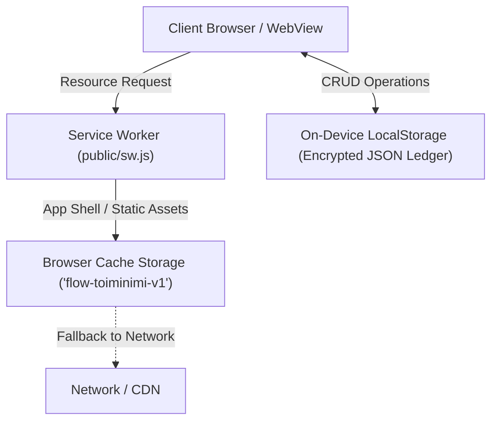
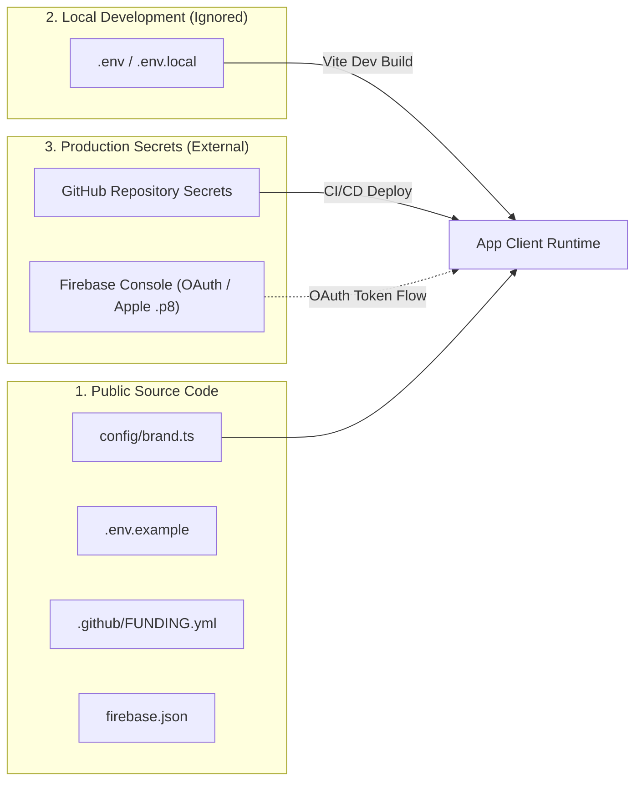

# System Architecture & Technical Specifications
## Project: Toiminimi Flow

---

## 1. Architectural Philosophy: The Two-Tier Privacy Model

Toiminimi Flow is designed for Finnish sole traders (*toiminimiyrittäjät / yksityiset elinkeinonharjoittajat*). Accounting data contains sensitive personal income, billing rates, client identities, and profit margins.

To balance zero-friction onboarding with modern multi-device convenience, the system is architected in **Two Distinct Tiers**:

```
┌────────────────────────────────────────────────────────────────────────────────────────┐
│                                 TOIMINIMI FLOW SUITE                                   │
└───────────────────────────────────────────┬────────────────────────────────────────────┘
                                            │
               ┌────────────────────────────┴────────────────────────────┐
               ▼                                                         ▼
┌──────────────────────────────────────────────┐ ┌──────────────────────────────────────────────┐
│  Tier 1: Instant Local Mode (Unregistered)   │ │  Tier 2: Registered Cloud Sync (Firebase)    │
├──────────────────────────────────────────────┤ ├──────────────────────────────────────────────┤
│ • Zero signup or login required              │ │ • Google & Apple Sign-In ONLY                │
│ • Runs 100% on-device in browser storage     │ │ • Firebase Authentication backend            │
│ • No backend servers or user tracking        │ │ • Cloud receipt archival (Drive/iCloud/GCS)  │
│ • Receipts stored via Link / File Path       │ │ • Seamless cross-device encrypted sync       │
│ • Complete single-entry bookkeeping & PDF    │ │ • Zero cloud lock-in: user owns their data   │
│ • Form 5 & VAT OmaVero 1-click helpers       │ │ • Total privacy: only Auth ID is preserved   │
└──────────────────────────────────────────────┘ └──────────────────────────────────────────────┘
```

### Tier 1: Instant Guest Mode (Current Baseline)
- **Zero Signup Friction**: Sole traders can start using the application immediately without creating an account or providing email/passwords.
- **Client-Side Zero Knowledge**: Ledger data is stored strictly in browser storage (`localStorage` / Cache). No telemetry, no third-party ad tracking, no corporate database.
- **External Receipt Links & Local Paths**: Because browser `localStorage` is capped at ~5MB, receipts are referenced as URLs (Google Drive, iCloud, Dropbox, OneDrive) or local paths (`/receipts/2026/01.pdf`). This ensures storage remains practically unlimited and lightning-fast.
- **Complete Feature Parity**: Full invoicing, PDF generation, tax calculations, Form 5 mapping, and JSON backup/restore work 100% offline.

### Tier 2: Registered Cloud Sync (Firebase Backend Roadmap)
- **Authentication**: Strict **Google OAuth** and **Apple Sign-In** only. No custom password databases, no unvetted credential storage.
- **Personal Cloud Storage**: Receipts upload directly to personal cloud storage (Google Drive, iCloud, or Firebase Cloud Storage).
- **Encrypted Sync**: Firebase Firestore / Storage manages cross-device synchronization between mobile and desktop while maintaining end-to-end data ownership.

---

## 2. Component Hierarchy & Module Map

```mermaid
graph TD
    Root["index.tsx (Entry Point)"]
    App["App.tsx (Navigation Shell & Responsive Layout)"]
    
    subgraph Views ["Core Application Views"]
        Dash["Dashboard.tsx (Cashflow, Tax Safe, Recharts)"]
        TaxC["TaxCenter.tsx (VAT & Tax Deadlines)"]
        Deduct["DeductionsView.tsx (Mileage 378 & Home Office)"]
        InvForm["InvoiceForm.tsx (Invoicing & Itemization)"]
        ExpForm["ExpenseForm.tsx (Expense Vouchers & Links)"]
        CustMgr["CustomerManager.tsx (Client Directory)"]
        BizForm["BusinessInfoForm.tsx (Business Profile & IBANs)"]
        DataBak["DataBackup.tsx (JSON Export & Restore)"]
    end

    subgraph Modals ["Specialized Assisted Modals"]
        F5Modal["Form5AssistantModal.tsx (OmaVero Line 300-380 Helper)"]
        PrepModal["PrepaymentGuideModal.tsx (Ennakkovero Guide)"]
        SettModal["SalesSettlementModal.tsx (Card/POS Payouts)"]
    end

    subgraph Primitives ["Apple HIG UI Primitives"]
        BSheet["components/ui/BottomSheet.tsx (Gesture Modal)"]
        PullRef["components/ui/PullToRefresh.tsx (iOS Haptic Pull)"]
        TextRev["components/ui/TextReveal.tsx (Inspection Popover)"]
    end

    subgraph Services ["Domain Engines"]
        Vero["services/veroTaxEngine.ts (Finnish Tax Rules)"]
        Format["services/formatUtils.ts (SFS 4175 Formatting)"]
        Store["services/storageService.ts (CRUD & Reference Gen)"]
        PDF["services/pdfService.ts (jsPDF Finnish Payment Slip)"]
        Cal["services/calendarService.ts (RFC 5545 .ics Export)"]
    end

    Root --> App
    App --> Dash & TaxC & Deduct & InvForm & ExpForm & CustMgr & BizForm & DataBak
    TaxC --> F5Modal
    Dash --> PrepModal & SettModal
    App -.-> BSheet & PullRef
    Dash & CustMgr -.-> TextRev

    Dash & TaxC & Deduct --> Vero
    InvForm & ExpForm & Dash & TaxC --> Format
    InvForm --> PDF
    Dash & TaxC --> Cal
    Dash & TaxC & Deduct & InvForm & ExpForm & CustMgr & BizForm & DataBak --> Store
```



---

## 3. Data Models (`types.ts`)

### Metadata & Sync Primitives
- **`SyncMetadata`**:
  - `schemaVersion`: Numeric data schema version (`2`).
  - `deviceId`: Cryptographically strong UUIDv4 identifier (`crypto.randomUUID()`).
  - `lastModified`: ISO 8601 timestamp of latest local modification.
  - `dirtyCount`: Integer counter of unbacked/unsynced mutations.
  - `lastBackupAt`: ISO 8601 timestamp of last exported JSON backup.
- **`BaseSyncEntity`** (applied across all core entities):
  - `id`: Unique identifier (UUIDv4).
  - `createdAt`: ISO 8601 creation timestamp.
  - `updatedAt`: ISO 8601 modification timestamp.
  - `deletedAt`: Optional ISO 8601 timestamp for soft-deletion / tombstones (enables conflict-free eventual sync).
  - `version`: Monotonic revision number for conflict resolution.

### Primary Entities
1. **`Invoice`**:
   - `id`, `invoiceNumber`, `invoiceDate`, `dueDate`, `paymentDuration`, `referenceNumber` (Finnish viitenumero).
   - Sender & recipient contact details, IBAN, BIC.
   - `items: InvoiceItem[]` (`quantity`, `unitPrice` VAT-inclusive, `vatRate`).
   - `status`: `'draft' | 'sent' | 'paid' | 'overdue'`.
   - `notes`, `updatedAt`, `deletedAt`, `version`.
2. **`Expense`**:
   - `id`, `paymentDate`, `notes`, `updatedAt`, `deletedAt`, `version`.
   - `receiptUrl` (Sanitized HTTP/HTTPS URL, cloud sharing link, or local path).
   - `receiptFileName` (Original receipt file name for 0-storage local folder matching).
   - `items: ExpenseItem[]` (`description`, `amount` gross, `vatRate`, `category: ExpenseCategory`).
3. **`SalesSettlement`**:
   - Provider (`iZettle`, `SumUp`, `Stripe`, `Wolt`, `Foodora`, `Cash`, `Other`).
   - `grossAmount`, `feeAmount` (deductible business operating expense), `netAmount`.
   - `date`, `description`, `reference`, `updatedAt`, `deletedAt`.
4. **`MileageEntry`**:
   - `date`, `route`, `kilometers`, `purpose`, `passengers`, `ratePerKm` (€0.55 standard 2026).
   - `deductionAmount`, `updatedAt`, `deletedAt`.
5. **`HomeOfficeDeduction`**:
   - `method` (`tier_1` €980, `tier_2` €490, `tier_3` €245, or `actual`).
   - `year`, `actualExpensesAmount`, `calculatedDeduction`, `updatedAt`, `deletedAt`.
6. **`TaxSettings`**:
   - `vatPeriod` (`year`, `quarter`, `month`, `exempt`).
   - `personalTaxRate` (e.g. 13.0%), `prepaymentTaxAssessed` (annual ennakkovero decision).
   - `updatedAt`, `deletedAt`.

---

## 4. Single-Entry Cash-Basis Bookkeeping Flow (*Maksuperusteinen*)

Under Chapter 7 of the Finnish Accounting Act (*Kirjanpitolaki*) and the Business Tax Act (*EVL*), sole traders are legally entitled to single-entry cash-basis bookkeeping:
- **Income Recognition**: Recorded when funds hit your bank account or payment terminal settlement.
- **Expense Recognition**: Recorded when payment is transacted from business card or bank account.
- **Receipt Archival**: All vouchers and receipts must be preserved for **6 years** from the end of the financial year.

---

## 5. Progressive Web App (PWA) & Offline Runtime Architecture



### Key Technical Aspects
1. **Zero-Network Availability**: The service worker intercepts requests for the HTML app shell, Inter variable font binary, and application scripts, serving them immediately from cache.
2. **Data Resiliency**: All business ledger data is stored in synchronous on-device `localStorage` (`flow_invoices`, `flow_expenses`, `flow_settings`, etc.). An internet outage or dead-zone in Lapland never impedes invoice drafting, mileage logging, or tax reserve calculations.
3. **Cross-OS Installability**:
   - iOS: "Add to Home Screen" operates with full standalone status bar treatment, safe-area insets (`env(safe-area-inset-top)` / `bottom`), and disabled elastic bounce on root containers.
   - Android & Desktop (Chrome/Edge): Native install prompt support, custom launcher squircle icons (`public/icons/icon.svg`), and background sync readiness.

---

## 6. Open-Source Configuration & Environment Architecture

To keep the open-source codebase modular, forkable, and strictly decoupled from instance-specific deployments, configuration is handled across three layers:



### 1. Centralized Brand & Metadata Hub (`config/brand.ts`)
- Manages creator attribution, Ko-fi coffee sponsorship links, GitHub repository URLs, and custom production domains (`toiminimiflow.fi`).
- Contains reactive getters (`isCustomDomainConfigured`, `hasSponsorLink`) ensuring UI cards gracefully hide or display sponsor links without code edits.

### 2. Tier 2 Firebase Authentication Blueprint (Planned)
- Supports **Google Sign-In** and **Apple Native Sign-In** strictly via standard OAuth providers.
- No user credentials, passwords, or emails are stored in an application database.
- Private Apple `.p8` keys reside exclusively within the Firebase Console and never touch git commits or client code.
- If Firebase environment variables are omitted or empty, the app seamlessly defaults to 100% offline Tier 1 Guest Mode.

### 3. Cookieless GDPR Telemetry Pipeline (Planned)
- Telemetry wrapper loaded conditionally only when `VITE_GA_MEASUREMENT_ID` is present.
- Configured with Google Consent Mode v2 (`analytics_storage: 'denied'`, `ad_storage: 'denied'`).
- Sends stateless, aggregate technical pings without writing cookies or tracking identifiers across sessions, exempting the application from mandatory EU cookie consent modals.

---

## 7. Sync-Ready Storage & Zero-Storage Receipt Architecture

To prepare the application for eventual multi-device cloud synchronization (Google Drive `appDataFolder` / iCloud) without introducing breaking schema migrations or bloat, storage services operate under the following engineering specifications:

```
┌───────────────────────────────────────────────────────────────────────────────────────┐
│                    ZERO-STORAGE RECEIPT REFERENCE ARCHITECTURE                        │
└───────────────────────────────────────────────────────────────────────────────────────┘
                                   User Attaches Receipt
                                             │
                       ┌─────────────────────┴─────────────────────┐
                       ▼                                           ▼
            Local Receipt File (.pdf/.jpg)               Cloud / Web URL Link
                       │                                           │
         Extract File Name & Local Path               Validate Protocol (http/https)
         (0 bytes stored in localStorage)             (0 binary data stored)
                       │                                           │
                       ├─────────────────────┬─────────────────────┤
                       ▼                                           ▼
             Chromium Browsers                           Other Platforms
     (File System Access API Directory)            (Clipboard OS Lookup Fallback)
                       │                                           │
         IndexedDB: toiminimi_fs_db                   1-Click Copy Exact Path
         Direct 1-Click File Open via                 to Clipboard for File Explorer
         Ephemeral URL.createObjectURL                / macOS Spotlight Search
```

### 1. Zero-Binary Storage Policy
- **The Problem**: Web applications that encode image/PDF attachments as Base64 strings immediately saturate the browser's ~5MB `localStorage` limit after 10–20 receipt scans, causing fatal `QuotaExceededError` crashes.
- **The Solution**: Toiminimi Flow stores **strictly 0 bytes** of binary image data in `localStorage`.
- Only reference metadata is recorded:
  - `receiptUrl`: Cloud link (Google Drive, iCloud, Dropbox, OneDrive) or relative/absolute local file path (`C:/Kuitit/2026/01.pdf` or `receipts/alv_2026.pdf`).
  - `receiptFileName`: Clean original file name (`kuitti_04112026.pdf`) used for smart local folder lookup.
- Strict input sanitization in `services/receiptFileService.ts` rejects any Base64 strings (`data:image/...`), stripping unauthorized payloads automatically.

### 2. High-Performance Local Folder Integration
- Supported Chromium browsers (Chrome, Edge, Opera, Brave) leverage the **File System Access API** (`window.showDirectoryPicker()`):
  1. The user connects their local receipts folder once (e.g. `C:\Users\...\Documents\Kuitit` or iCloud synced folder).
  2. The secure `FileSystemDirectoryHandle` is stored in IndexedDB (`toiminimi_fs_db`).
  3. Clicking **"Open Receipt"** resolves the file directly within the connected folder handle, generates an ephemeral `URL.createObjectURL(file)` in memory, and opens the PDF or image in a dedicated browser tab.
  4. Ephemeral URLs are automatically revoked when the window unloads, preventing memory leakage.
- For browsers without File System Access API support (Firefox, Safari iOS), the app provides a **1-click "Copy Path"** action with clear toast feedback, allowing instant lookup via OS File Explorer / Finder / Spotlight.

### 3. Sync-Ready Metadata & Tombstones (Schema v2)
- **Cryptographic UUIDv4 Identifiers**: All entities use `crypto.randomUUID()` guaranteeing globally unique keys across distributed devices.
- **Soft Deletion & Tombstones**: Record deletions set a `deletedAt: string` ISO timestamp rather than immediately deleting records from storage. This guarantees that when cloud sync is connected, a deletion on Device A correctly propagates to Device B instead of being resurrected as a "new" record.
- **Dirty Tracking**: `dirtyCount` increments on every create, update, or soft-delete, tracking unsynced mutations and warning users in the Data Backup view when unexported ledger changes exist.
- **Purge Utility**: `storageService.purgeTombstones()` provides an on-demand maintenance action in Data Backup to permanently clean up deleted records when desired.


